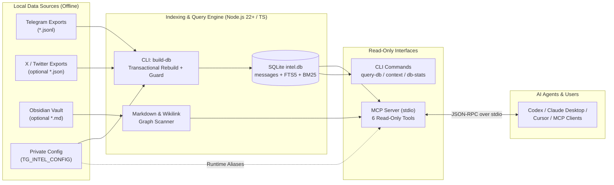

<div align="center">

# telegram-search-mcp

**Local-first, read-only MCP server & SQLite FTS5 search engine for exported Telegram chats, X posts, and Obsidian vaults.**

[](https://nodejs.org/)
[](https://www.typescriptlang.org/)
[](https://www.sqlite.org/fts5.html)
[](https://modelcontextprotocol.io/)
[](LICENSE)

**English** | [简体中文](README_zh.md)

</div>

---

## Overview

High-volume Telegram groups hold valuable troubleshooting logs, firsthand reports, and discussions—yet native chat search lacks ranking, cross-language synonym matching, and thread-level context. Feeding raw chat dumps straight to an LLM also causes hallucinations and broken citations.

`telegram-search-mcp` turns your **local exported JSONL chat archives** (plus optional X/Twitter exports and an Obsidian knowledge base) into a fast, citable **SQLite FTS5** database exposed **read-only over MCP (Model Context Protocol)** and CLI.

Every search hit carries exact `chat_id`, `message_id`, sender, timestamp, and permalink, allowing AI agents (Codex, Claude Desktop, Cursor, etc.) to inspect full reply chains before answering with grounded quotes.

> **Strictly local & read-only:** `telegram-search-mcp` never connects to Telegram, never runs Takeout, never requires API keys or user sessions, and never sends your chat data to any cloud service.

---

## Features

- **Zero External Database Dependencies** — Powered by Node.js built-in `node:sqlite` with FTS5 full-text indexing and BM25 ranking.
- **Bilingual CJK/English Search & Alias Expansion** — Segments Chinese/English text via `Intl.Segmenter`, supports multi-tier FTS fallback (`strict AND` -> `pairwise` -> `relaxed OR`), and expands customizable bilingual synonym groups (e.g., `k8s` <-> `Kubernetes` <-> `容器编排`).
- **Reply-Chain Context Reconstruction** — `read_context` walks up `reply_to_id` ancestors, collects direct replies, and fetches surrounding chronological messages so agents never quote out of context.
- **Multi-Source Unified Retrieval** — Query Telegram group archives, optional X/Twitter posts & bookmarks, and an optional local Obsidian vault (with frontmatter tags, aliases, `[[wikilinks]]`, and backlinks) through one MCP server.
- **Hot-Reload Ready** — Each MCP tool call opens SQLite fresh, so scheduled background `build-db` runs take effect immediately without restarting your AI client.
- **Data-Safety Guardrails** — `build-db` rebuilds atomically inside a single transaction and refuses to wipe an existing database if the export directory is missing or empty.
- **Privacy-First External Config** — Keep private chat IDs, excluded groups, and domain-specific synonym tables completely outside the repository via `--config` or `TG_INTEL_CONFIG`.

---

## Architecture



---

## Quick Start

### Prerequisites

- **Node.js `>= 22.13`** (uses built-in `node:sqlite`)

### 1. Install & Verify

```bash
git clone https://github.com/deimos6677/deimos.git telegram-search-mcp
cd telegram-search-mcp
npm install
npm test
```

### 2. Build a Demo Database (Included Sample Data)

Try it immediately with the anonymized fixtures in `examples/`:

```bash
npx tsx src/cli.ts build-db \
  --db data/demo.db \
  --input examples \
  --config examples/config.example.json

npx tsx src/cli.ts query-db "PostgreSQL" --db data/demo.db --days 0
npx tsx src/cli.ts context 10001 102 --db data/demo.db
npx tsx src/cli.ts db-stats --db data/demo.db
```

### 3. Input JSONL Format

Place one or more `*.jsonl` files in your export directory (one JSON object per line):

```json
{"id":"101","chatId":"10001","senderId":"u1","senderName":"Alice","timestamp":1790000000,"text":"Docker PostgreSQL volume permission error","replyToId":null,"links":[{"url":"https://example.com/guide"}]}
```

- **Required:** `id`, `chatId`, `senderId`, `senderName`, `timestamp` (Unix seconds), `text`
- **Optional:** `replyToId`, `links`, `deletedAt` (messages with `deletedAt` are skipped)

---

## MCP Integration

### Run Standalone

```bash
TG_INTEL_DB=/path/to/intel.db \
TG_INTEL_CONFIG=/path/to/private-config.json \
TG_INTEL_WIKI_DIR=/path/to/obsidian-vault \
npm run mcp
```

### Configure in Codex / Claude Desktop / Cursor

```json
{
  "mcpServers": {
    "telegram-search-mcp": {
      "command": "node",
      "args": [
        "/absolute/path/to/telegram-search-mcp/node_modules/tsx/dist/cli.mjs",
        "/absolute/path/to/telegram-search-mcp/src/mcp-server.ts"
      ],
      "env": {
        "TG_INTEL_DB": "/absolute/path/to/intel.db",
        "TG_INTEL_CONFIG": "/absolute/path/to/private-config.json",
        "TG_INTEL_WIKI_DIR": "/absolute/path/to/obsidian-vault"
      }
    }
  }
}
```

> `TG_INTEL_CONFIG` and `TG_INTEL_WIKI_DIR` are both optional. Wiki tools (`search_wiki`, `read_wiki`) are automatically registered only when `TG_INTEL_WIKI_DIR` points to an existing directory.

### Exposed MCP Tools

| Tool | Description |
| --- | --- |
| `search_messages` | Full-text FTS5 + BM25 search with bilingual alias expansion. Filter by `source` (`all`/`tg`/`x`), `chat`, `sender`, `days` (`0` = full history), and `limit`. |
| `read_context` | Reconstructs full conversation context: reply ancestor chain, direct replies, and surrounding chronological messages (`before` / `after`). |
| `recent_messages` | Lists recent substantive messages (noise-filtered), newest first. |
| `db_stats` | Returns total message counts, date coverage, and per-channel latest sync timestamp. |
| `search_wiki` | Searches or lists Markdown notes in an Obsidian vault by title, alias, tag, or body *(requires `TG_INTEL_WIKI_DIR`)*. |
| `read_wiki` | Reads a full Obsidian note together with outgoing `[[links]]` and incoming backlinks *(requires `TG_INTEL_WIKI_DIR`)*. |

For recommended agent prompting & citation rules, see [SKILL.md](SKILL.md).

---

## Custom Configuration (`TG_INTEL_CONFIG`)

Keep personal chat IDs and custom synonym tables out of source control by placing a JSON file outside the repo (see [examples/config.example.json](examples/config.example.json)):

```json
{
  "chats": {
    "10001": { "name": "Engineering Group", "username": "engineering_demo" }
  },
  "excludedChats": ["99999"],
  "aliasGroups": [
    ["k8s", "kubernetes", "容器编排"],
    ["pg", "postgres", "postgresql"]
  ],
  "compoundFixes": [
    ["云\\s+原\\s+生", "云原生"]
  ]
}
```

- Pass `--config <path>` to `build-db`, or set `TG_INTEL_CONFIG` for both CLI and MCP server.
- `chats` maps raw numeric chat IDs to readable names and optional public `t.me/<username>/<msg_id>` links.
- `excludedChats` skips specified chats during database builds.
- `aliasGroups` & `compoundFixes` extend the built-in generic query expansion rules at search time.

---

## CLI Reference

| Command | Usage |
| --- | --- |
| `build-db` | `npx tsx src/cli.ts build-db --db <intel.db> --input <jsonl-dir> [--names <sender-names.json>] [--config <config.json>] [--x-dir <x-dir>] [--stats-out <stats.json>]` |
| `query-db` | `npx tsx src/cli.ts query-db "<query>" --db <intel.db> [--source all\|tg\|x] [--chat <chat>] [--sender <sender>] [--days 0] [--limit 25]` |
| `context` | `npx tsx src/cli.ts context <chat_id> <message_id> --db <intel.db>` |
| `db-stats` | `npx tsx src/cli.ts db-stats --db <intel.db>` |
| `index` / `search` / `read` / `stats` | Legacy v0.1 JSON thread-clustering pipeline (`npx tsx src/cli.ts` prints full usage). |

---

## Privacy & Security

- **100% Local Processing** — No telemetry, no external network calls, no LLM API keys.
- **Git Safeguards** — `.gitignore` explicitly excludes `data/`, `out/`, `*.db`, `*.sqlite*`, `*.jsonl` (except sample fixtures), `.env*`, `chats.json`, `sender-names.json`, and `intel-config.json`.
- **Never Commit Real Archives** — Always store private exports, databases, and personal `config.json` files outside Git history.

---

## Project Structure

```text
├── src/
│   ├── db.ts          # SQLite FTS5 schema, transactional builder, BM25 query & Obsidian wiki reader
│   ├── mcp-server.ts  # Read-only MCP stdio server exposing 4 core + 2 optional wiki tools
│   ├── cli.ts         # CLI entry point for building, querying, and inspecting indexes
│   ├── thread.ts      # Message clustering, noise filtering & deduplication (v0.1 thread index)
│   ├── score.ts       # Heuristic thread scoring
│   ├── ingest.ts      # JSONL export reader
│   ├── search.ts      # In-memory thread search
│   ├── store.ts       # JSON index persistence
│   └── types.ts       # Shared TypeScript interfaces
├── examples/          # Anonymized JSONL and config.example.json fixtures
├── test/              # Node built-in test runner suite (MCP, FTS5, guardrails, config, threads)
├── SKILL.md           # Agent retrieval & evidence-citation workflow guide
├── README.md          # English documentation
└── README_zh.md       # Simplified Chinese documentation
```

---

## Limitations

- Lexical / keyword search (FTS5 + BM25 + alias expansion) only; no vector embeddings.
- `build-db` performs a full transactional rebuild rather than row-level incremental updates.
- Operates on exported snapshots rather than a live Telegram bot/MTProto stream.

## License

MIT — see [LICENSE](LICENSE).
