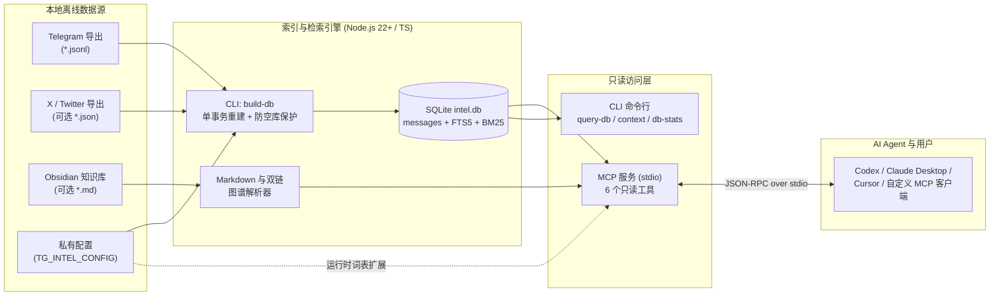

<div align="center">

# telegram-search-mcp

**用 SQLite FTS5 检索已导出的 Telegram 聊天和 X 帖子，沿回复链查看上下文。通过只读 MCP 接口还可以搜索本地 Obsidian 笔记。**

[](https://nodejs.org/)
[](https://www.typescriptlang.org/)
[](https://www.sqlite.org/fts5.html)
[](https://modelcontextprotocol.io/)
[](LICENSE)

[English](README.md) | **简体中文**

</div>

---

## 项目简介

高频交流的 Telegram 群聊里沉淀了大量一手排查记录、经验贴和讨论，但客户端自带搜索缺少相关性排序、跨语言同义词扩展和回复链还原；直接把原始记录丢给大模型，又容易出现幻觉、断章取义或编造出处。

CLI 将 Telegram JSONL 归档和可选的 X 导出记录写入 SQLite FTS5 索引。Obsidian 笔记直接从指定目录读取，不写入数据库。

每条检索命中都附带精确的 `chat_id`、`message_id`、发送者、时间戳和原消息链接，AI Agent（Codex、Claude Desktop、Cursor 等）可以在作答前拉取完整上下文并引用原文，拒绝拍脑袋编造。

> **数据边界：** 建库和检索在本机完成，不需要 Telegram 会话或模型密钥。MCP 客户端会收到它请求的原文；如果客户端使用云端模型，还需核对该客户端的数据处理设置。

---

## 核心特点

- **零外部数据库依赖** — 直接使用 Node.js 内置 `node:sqlite`，开箱即用 SQLite FTS5 全文索引与 BM25 排序。
- **中英文分词与双语别名扩展** — 基于 `Intl.Segmenter` 处理中文长词，支持多级回退检索（`严格 AND` -> `两两组合` -> `宽松 OR`），并支持自定义中英同义词映射（如 `k8s` <-> `Kubernetes` <-> `容器编排`）。
- **完整回复链上下文还原** — `read_context` 自动沿 `reply_to_id` 向上追溯被回复的祖先消息、向下收集直接回复，并附带前后时间窗消息，避免断章取义。
- **多源统一检索** — 一个 MCP 服务同时覆盖 Telegram 导出群聊、可选的 X/Twitter 帖子与书签，以及可选的本地 Obsidian 笔记库（自动解析 frontmatter 标签、别名、`[[双链]]` 与反链）。
- **免重启热更新** — 每次 MCP 工具调用按需打开数据库，后台定时跑完 `build-db` 后立即生效，无需重启 Codex / Claude 客户端。
- **事务重建与防清库保护** — `build-db` 在单事务内原子替换数据；若导出目录不存在或消息数为 0，直接报错中止，绝不误清空现有数据库。
- **隐私配置外置隔离** — 用 `--config` 或 `TG_INTEL_CONFIG` 指向仓库外的私有配置。真实导出和索引放在已忽略的 `data/`，不要替换仓库里已跟踪的示例文件。

---

## 技术架构



---

## 快速开始

### 环境要求

- **Node.js `>= 22.13`**（需包含内置 `node:sqlite` 模块）

### 1. 安装与运行测试

```bash
git clone https://github.com/deimos6677/telegram-search-mcp.git
cd telegram-search-mcp
npm install
npm test
```

### 2. 用内置脱敏示例体验全流程

仓库 `examples/` 自带脱敏测试数据，30 秒即可跑通建库与检索：

```bash
npx tsx src/cli.ts build-db \
  --db data/demo.db \
  --input examples \
  --config examples/config.example.json

npx tsx src/cli.ts query-db "PostgreSQL" --db data/demo.db --days 0
npx tsx src/cli.ts context 10001 102 --db data/demo.db
npx tsx src/cli.ts db-stats --db data/demo.db
```

### 3. 输入 JSONL 格式说明

导出目录中包含一个或多个 `*.jsonl` 文件，每行一条 JSON 消息：

```json
{"id":"101","chatId":"10001","senderId":"u1","senderName":"Alice","timestamp":1790000000,"text":"Docker 部署 PostgreSQL 时遇到 volume 权限报错","replyToId":null,"links":[{"url":"https://example.com/guide"}]}
```

- **必填字段：** `id`、`chatId`、`senderId`、`senderName`、`timestamp`（Unix 秒级时间戳）、`text`
- **可选字段：** `replyToId`、`links`、`deletedAt`（带该字段的已删除消息会被自动跳过）

---

## MCP 接入指南

### 命令行独立启动

```bash
TG_INTEL_DB=/path/to/intel.db \
TG_INTEL_CONFIG=/path/to/private-config.json \
TG_INTEL_WIKI_DIR=/path/to/obsidian-vault \
npm run mcp
```

### 在 Codex / Claude Desktop / Cursor 中配置

```json
{
  "mcpServers": {
    "telegram-search-mcp": {
      "command": "node",
      "args": [
        "/absolute/path/to/telegram-search-mcp/node_modules/tsx/dist/cli.mjs",
        "/absolute/path/to/telegram-search-mcp/src/mcp-server.ts"
      ],
      "env": {
        "TG_INTEL_DB": "/absolute/path/to/intel.db",
        "TG_INTEL_CONFIG": "/absolute/path/to/private-config.json",
        "TG_INTEL_WIKI_DIR": "/absolute/path/to/obsidian-vault"
      }
    }
  }
}
```

> `TG_INTEL_CONFIG` 和 `TG_INTEL_WIKI_DIR` 均为可选。只有当 `TG_INTEL_WIKI_DIR` 指向有效目录时，才会自动注册 Obsidian 知识库工具（`search_wiki`、`read_wiki`）。

### 提供的 6 个只读 MCP 工具

| 工具名 | 功能说明 |
| --- | --- |
| `search_messages` | SQLite FTS5 + BM25 全文检索与双语别名扩展；支持按 `source`（`all`/`tg`/`x`）、`chat`、`sender`、`days`（`0` 为全量历史）与 `limit` 筛选。 |
| `read_context` | 还原指定命中消息的完整讨论上下文：回复祖先链 + 直接回复 + 前后时间窗消息（`before` / `after`）。 |
| `recent_messages` | 按时间倒序列出近期有效讨论（自动过滤无意义灌水）。 |
| `db_stats` | 查看资料库统计：Telegram 与 X 消息总数、时间覆盖区间、各群最新同步时间。 |
| `search_wiki` | 搜索或列出本地 Obsidian 笔记库的标题、别名、标签与出链 *(需配置 `TG_INTEL_WIKI_DIR`)*。 |
| `read_wiki` | 读取单篇 Obsidian 笔记正文，并自动附上正向 `[[双链]]` 与反向链接 *(需配置 `TG_INTEL_WIKI_DIR`)*。 |

推荐的 Agent 检索与原文引用纪律见 [SKILL.md](SKILL.md)。

---

## 自定义私有配置（`TG_INTEL_CONFIG`）

为了不把真实群 ID 和个人领域词表提交到 Git，可将配置 JSON 放在仓库之外（参考 [examples/config.example.json](examples/config.example.json)）：

以下群号均为虚构，示例不绑定任何公开群用户名。若已指定的配置文件不存在，建库会中止，不会在缺少排除名单的情况下继续。

```json
{
  "chats": {
    "10001": { "name": "技术交流群" }
  },
  "excludedChats": ["99999"],
  "aliasGroups": [
    ["k8s", "kubernetes", "容器编排"],
    ["pg", "postgres", "postgresql"]
  ],
  "compoundFixes": [
    ["云\\s+原\\s+生", "云原生"]
  ]
}
```

- 构建数据库时通过 `--config <path>` 指定，或在运行 CLI / MCP 服务时通过环境变量 `TG_INTEL_CONFIG` 注入。
- `chats`：将数字群 ID 映射为可读群名，并可配置公开群 `username` 以生成 `t.me/<username>/<msg_id>` 跳转链接。
- `excludedChats`：建库时自动忽略指定群聊。
- `aliasGroups` / `compoundFixes`：在内置通用词表基础上叠加你的专属同义词与分词修正规则。

---

## CLI 命令速查

| 命令 | 用法 |
| --- | --- |
| `build-db` | `npx tsx src/cli.ts build-db --db <intel.db> --input <jsonl-dir> [--names <sender-names.json>] [--config <config.json>] [--x-dir <x-dir>] [--stats-out <stats.json>]` |
| `query-db` | `npx tsx src/cli.ts query-db "<关键词>" --db <intel.db> [--source all\|tg\|x] [--chat <群名>] [--sender <昵称>] [--days 0] [--limit 25]` |
| `context` | `npx tsx src/cli.ts context <chat_id> <message_id> --db <intel.db>` |
| `db-stats` | `npx tsx src/cli.ts db-stats --db <intel.db>` |
| `index` / `search` / `read` / `stats` | 兼容保留的 v0.1 JSON 话题聚类索引流水线（运行 `npx tsx src/cli.ts` 查看参数）。 |

---

## 隐私与安全设计

- **完全本地运行** — 无遥测上报、无联网请求、无需填写第三方密钥。
- **多重 Git 防误提交规则** — `.gitignore` 默认忽略 `data/`、`out/`、`*.db`、`*.sqlite*`、`*.jsonl`（示例除外）、`.env*`、`chats.json`、`sender-names.json` 与 `intel-config.json`。
- **数据与代码物理隔离** — 请始终将真实导出记录、SQLite 数据库和私人配置文件保存在仓库目录之外。

---

## 目录结构

```text
├── src/
│   ├── db.ts          # SQLite FTS5 建库、事务防清库、BM25 检索与 Obsidian 双链读取
│   ├── mcp-server.ts  # 只读 MCP stdio 服务端（4 个核心工具 + 2 个可选知识库工具）
│   ├── cli.ts         # 建库、检索、上下文查看与统计命令行入口
│   ├── thread.ts      # 话题切分、灌水过滤与去重（v0.1 线程索引）
│   ├── score.ts       # 话题质量评分
│   ├── ingest.ts      # JSONL 导出解析
│   ├── search.ts      # 内存线程检索
│   ├── store.ts       # JSON 索引读写
│   └── types.ts       # 公共 TypeScript 类型定义
├── examples/          # 脱敏 JSONL 与 config.example.json 模板
├── test/              # Node 内置测试套件（MCP、FTS5、防清库、外置配置、线程切分）
├── SKILL.md           # Agent 检索与原文引用工作流规范
├── README.md          # 英文项目说明
└── README_zh.md       # 简体中文项目说明
```

---

## 当前限制

- 当前为关键词与双语别名全文检索（FTS5 + BM25），不包含向量语义检索。
- 每次 `build-db` 为单事务全量重建，而非逐条增量写入。
- 查询基于本地导出快照，并非实时 Telegram 消息流。

## 开源协议

MIT License — 详见 [LICENSE](LICENSE)。
